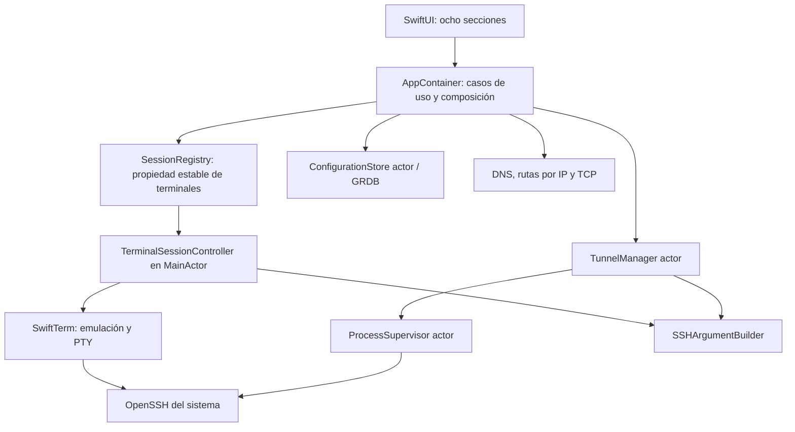

# Arquitectura nativa

Actualización 2026-11-15: se incorporan ConnectionOrganizer, el lienzo editable,
AccessBastionsImporter y RepositoryService. `Configuration.organization` y
`repositoryRoots` son campos opcionales en metadata para leer bases/JSON previos.
RepositoryController mantiene las operaciones Git en AppContainer y las cancela
al salir. Los procesos Git usan el mismo ejecutor acotado; sus fallos no exponen
salida de remotos que pueda contener credenciales. Los workspaces de VS Code se
guardan bajo `Editor/`, separados del runtime SSH que se elimina al cerrar.

SSHRuntimeFiles usa un directorio temporal privado si la ruta solicitada contiene
espacios o metacaracteres: OpenSSH inserta `-F` sin comillas en el ProxyCommand
implícito de ProxyJump. No se cambia la ruta de SQLite ni la configuración del
usuario. La presentación usa SectionPalette en Environment para aplicar el color
de la sección sin estado global mutable.

ConnectionCatalogMigration reorganiza únicamente las carpetas importadas bajo
PRE, PRO y Maqueta al cargar o importar. Es idempotente, conserva los IDs y las
rutas de conexión y se guarda mediante la transacción de ConfigurationStore.
`HostProfile.isJumpProfile` es opcional para mantener compatibilidad con JSON
previos. El catálogo de Túneles comparte esos perfiles con los saltos referenciados;
los editores de conexiones y el diagrama seleccionan el perfil guardado por ID.
Los reenvíos de puertos conservan su pestaña y procesos independientes.

Los repositorios se muestran en filas con acciones por iconos. ConsoleLauncher
crea un script privado en `Editor/` para abrir Claude Code en la carpeta elegida;
VSCodeLauncher conserva la tarea de Claude en un workspace externo al repositorio.

## Capas y dependencias

`native/` contiene un paquete Swift 6.2, macOS 15+, dos productos y dos targets
 de pruebas. `ORIApp` es el ejecutable SwiftUI/AppKit; `ORICore` es una biblioteca
sin dependencias de SwiftUI ni AppKit. Las dependencias externas están fijadas en
Package.swift y Package.resolved: SwiftTerm 1.99.1 y GRDB 7.12.0.

## Dominio

Models.swift define perfiles de host y conexión, rutas ordenadas, túneles, VPN,
requisitos, workspaces, carpetas, comandos, preferencias, diagnósticos, eventos y
sesiones transitorias. IDs de texto conservan los UUID históricos sin regenerarlos.
Validation.swift valida campos, referencias, ciclos, IDs únicos y límites antes de
persistir. Las etiquetas son valores del host. Los tipos VPN históricos se
conservan solo para leer archivos anteriores; ORIApp ya no los consulta ni aplica.

Los saltos referenciados toman los parámetros **directos** del host guardado,
como en la versión original; sus rutas no se expanden recursivamente. Un alias
solo puede aparecer una vez en una ruta explícita, también frente al destino:
OpenSSH selecciona configuración por alias, no por nuestro UUID. Usar alias distintos
resuelve las topologías con la misma IP y configuraciones diferentes.

## Aplicación y propiedad

Un AppContainer, propiedad de SwiftUI App, compone servicios y mantiene estado de
presentación en MainActor mediante Observation. No hay un singleton propio mutable.
Las vistas solicitan casos de uso; no crean procesos durante su renderizado.

SessionRegistry conserva un TerminalSessionController por sesión. Cada controlador
posee una vista SwiftTerm, delegado de seguridad, observación de log y archivos de
runtime. NSViewRepresentable solo adjunta/desadjunta esa vista; su desmontaje no
termina procesos. Una ventana principal evita adjuntar la misma NSView a dos
ventanas simultáneas. Cerrar la ventana no equivale a salir de la aplicación.

## SSH y bastiones

SSHArgumentBuilder construye arrays para `/usr/bin/ssh`, nunca una shell. Crea un
archivo privado sin secretos, con opciones de bastiones e Include de configuración
local cuando el usuario lo autoriza. Se respeta el orden usuario/sistema. `ssh -G`
es la autoridad para alias, Include, Match y ProxyJump; no se interpreta de nuevo
la gramática. Match exec puede ejecutar comandos locales: la opción de confiar
en configuración es explícita y se apaga al importar perfiles históricos.

El PTY y el resize se delegan a SwiftTerm. Para terminales, OpenSSH escribe sus
metadatos de diagnóstico en un archivo 0600; un actor lo lee fuera de MainActor.
Se considera autenticación confirmada por el mensaje del cliente local y sesión
utilizable cuando OpenSSH confirma la petición shell. La salida del servidor no
se usa para deducir autenticación. Los errores permanentes no reconectan; al
reconectar solo se abre una shell, sin reenviar comandos guardados ni el teclado.

## Túneles y procesos

TunnelManager es un actor: reserva una generación antes de operaciones async,
evita arranques duplicados, detecta conflictos propios y hace preflight de bind
local. El bind de OpenSSH sigue siendo la autoridad ante carreras con otras apps.
Cada túnel usa un proceso independiente `-N -T`, `BatchMode=yes` y
`ExitOnForwardFailure=yes`. No se usa `-f` ni un PID restaurado.

ProcessSupervisor posee Foundation Process y una lectura DispatchIO independiente.
Coordina EOF y terminación y limita el drenaje cuando un descendiente conserva
stderr; nunca espera un EOF indefinido dentro de un actor. TERM y, si es necesario,
KILL solo se envían al hijo del Process vivo que posee. Se liberan canales y
continuaciones al terminar. Los metadatos no se persisten como procesos activos.

Estados: stopped → starting → active; desde fallos transitorios puede pasar por
reconnecting con máximo, backoff exponencial y jitter. Stop invalida la generación
y cancela tareas antes de esperar al proceso. Cada retry vuelve a consultar la
configuración del túnel. Autenticación, establecimiento del forwarding y sonda del servicio
son datos separados. Para -R se exige la confirmación remota de OpenSSH.

## Red y credenciales

ConnectivityMonitor observa conectividad, DNS y rutas para invalidar diagnósticos
obsoletos. No hay detector ni coordinador VPN, búsqueda de Ivanti, requisitos VPN
ni sondeos automáticos a servidores corporativos en ORIApp.

SSHPasswordStore guarda un JSON cifrado AES-GCM y una clave local privada,
separados de SQLite. SSHAskpass prepara un manifiesto sin secretos con los
endpoints de la ruta. El modo `--ssh-askpass` del mismo ejecutable consulta el
almacén únicamente para un prompt de contraseña que coincida exactamente con
el usuario y la dirección permitidos. Hay un único intento automático por
endpoint y sesión; el resto requiere entrada manual. La verificación de host
key nunca se responde automáticamente.

PortableArchive cifra Configuration y las contraseñas en un solo JSON mediante
AES-256-GCM con PBKDF2-HMAC-SHA256 y sal aleatoria. La exportación no contiene
la clave local. La importación recupera los secretos en el almacén propio.
El formato y los límites están en CREDENTIALS_PORTABLE.md.

## Persistencia e importación

ConfigurationStore serializa cada colección en tablas GRDB con ID y payload
Codable. Valida toda la configuración y escribe mediante una transacción con
upserts. Una revisión evita sobrescrituras obsoletas. Las relaciones se validan
en dominio porque también incluyen referencias dentro de rutas y workspaces.
No se depende de INSERT OR REPLACE ni de cascadas que borren comandos/historial.

Migraciones: v1_profiles crea colecciones, metadata y eventos; v2_import_receipts
registra hashes de importaciones CSV/JSON para impedir duplicados. El historial
se escribe en una tabla separada. Los eventos nativos no se purgan por límite de filas: solo se limita la consulta
reciente; la exportación local consulta todas las entradas. La base original solo
se abre en modo readonly.
La vista previa no escribe; el merge y los eventos importados se confirman en una
única transacción. Credenciales y estado de ejecución quedan fuera de los payloads.

## Distribución

El script de build genera un bundle .app con Info.plist, icono del proyecto y
recursos de GRDB; admite identidad Developer ID y usa firma ad hoc por defecto.
El proyecto Xcode comparte los mismos fuentes y productos SPM. No se activa App
Sandbox porque OpenSSH/PTY y archivos SSH del usuario lo requieren para este
modelo de distribución externo. No se añaden entitlements de JIT ni APIs privadas.
LaunchAgent/SMAppService y persistencia de procesos tras salir son trabajo separado.

## Selección y edición de carpetas

ConnectionFolderTree muestra solo carpetas con selección de ancho completo y
contadores que incluyen descendientes. HostsView limpia filtros y cambia a Filas
al elegir una carpeta; el catálogo completo de Conexiones no hereda el workspace
global. Los modos de diagrama siguen disponibles por elección explícita.

ConnectionOrganizer crea carpetas raíz, hijas, hermanas y superiores en una copia
validada antes de aplicar cambios. Insertar una superior conserva la rama y sus
IDs y solo cambia relaciones entre carpetas. updateGroup rechaza referencias
inexistentes y ciclos sin dejar mutaciones parciales. El menú contextual abre un
editor común y los movimientos por drag/drop reutilizan la misma validación.
